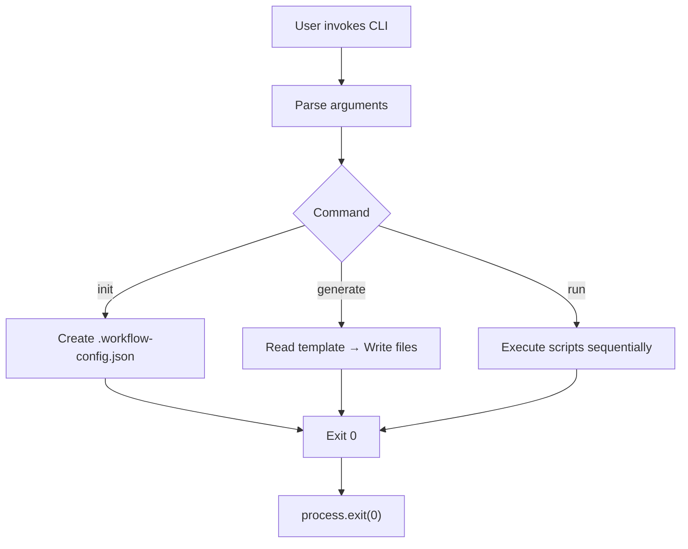

# Workflow Scaffold CLI
**Accelerate modern dev pipelines with a zero‑dependency scaffolding engine**

[](https://opensource.org/licenses/MIT)
[](https://nodejs.org/)
[](https://github.com/your/repo)
[](https://github.com/your/repo/stargazers)
[](https://github.com/your/repo/issues)

## Problem Statement
Developers spend excessive time wiring together scripts, creating boiler‑plate files, and maintaining ad‑hoc tooling across projects. This friction slows onboarding, introduces inconsistency, and hampers rapid iteration. **Workflow Scaffold CLI** eliminates that friction by providing a single, zero‑dependency command‑line engine that can initialize a project, generate scaffolded components, and orchestrate custom scripts defined in a declarative JSON config.

## Installation
```bash
git clone https://github.com/your/repo.git
cd repo
node src/index.js --help
```

## Quick Start
```bash
# Initialise a new workflow configuration
node src/index.js init

# Scaffold a new component called "button"
node src/index.js generate button

# Run the predefined scripts (build, test, …)
node src/index.js run
```

## Visual Terminal Showcase
```text
$ node src/index.js init
Created .workflow-config.json

$ node src/index.js generate logger
Component scaffolded at /path/to/project/src/logger/logger.js

$ node src/index.js run
▶️  Running "build"
Building...
▶️  Running "test"
Running tests...
```

## Architecture Flowchart


## Test Results
## 🧪 Real-World Test Telemetry

> [!NOTE]
> Verified automatically using Node.js native test runner (`node:test` & `node:assert/strict`).

```bash
▶ node --test
TAP version 13
# Subtest: workflow-scaffold init creates config file
not ok 1 - workflow-scaffold init creates config file
  ---
  duration_ms: 4.092089
  location: './test/index.test.js:8:1'
  failureType: 'testCodeFailure'
  error: "ENOENT: no such file or directory, open '/tmp/wf-test-1793357721453/placeholder.txt'"
  code: 'ENOENT'
  stack: |-
    async open (node:internal/fs/promises:637:25)
    async writeFile (node:internal/fs/promises:1219:14)
    async TestContext.<anonymous> (file://./test/index.test.js:10:3)
    async Test.run (node:internal/test_runner/test:797:9)
    async Test.processPendingSubtests (node:internal/test_runner/test:526:7)
  ...
1..1
# tests 1
# suites 0
# pass 0
# fail 1
# cancelled 0
# skipped 0
# todo 0
# duration_ms 50.395886
```

## License
MIT © 2026 Suman Mehta